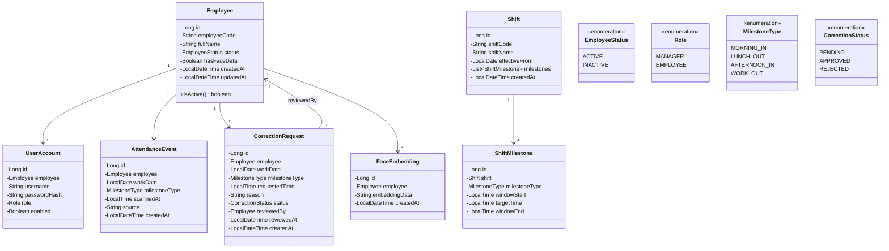
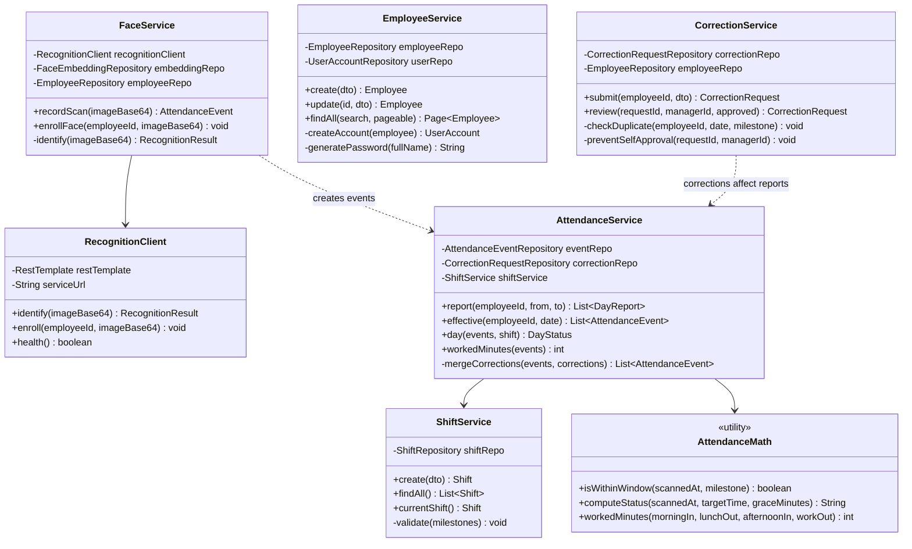

# Class Diagram: Backend Architecture

## Entity Layer



## Service Layer



## Controller Layer

```mermaid
classDiagram
    class FaceAttendanceController {
        -FaceService faceService
        +scan(image) ResponseEntity "POST /api/diem-danh (permitAll)"
    }

    class ManagementController {
        -EmployeeService employeeService
        -FaceService faceService
        -AttendanceService attendanceService
        -CorrectionService correctionService
        -ShiftService shiftService
        +getEmployees(search, pageable) Page "GET /api/employees"
        +createEmployee(dto) Employee "POST /api/employees"
        +updateEmployee(id, dto) Employee "PATCH /api/employees/{id}"
        +enrollFace(id, image) void "POST /api/employees/{id}/enroll"
        +getAttendance(from, to, page) Page "GET /api/attendance"
        +getCorrections(status) List "GET /api/corrections"
        +reviewCorrection(id, dto) Correction "PATCH /api/corrections/{id}"
        +getShifts() List "GET /api/shifts"
        +createShift(dto) Shift "POST /api/shifts"
    }

    class AuthController {
        +login(credentials) ResponseEntity "POST /api/auth/login"
        +logout() ResponseEntity "POST /api/auth/logout"
        +changePassword(dto) ResponseEntity "POST /api/auth/change-password"
        +me() UserInfo "GET /api/auth/me"
        +csrf() CsrfToken "GET /api/auth/csrf"
    }

    class EmployeeSelfController {
        -AttendanceService attendanceService
        -CorrectionService correctionService
        +myAttendance(from, to) List "GET /api/attendance/me"
        +submitCorrection(dto) Correction "POST /api/corrections"
    }

    FaceAttendanceController --> FaceService
    ManagementController --> EmployeeService
    ManagementController --> FaceService
    ManagementController --> AttendanceService
    ManagementController --> CorrectionService
    ManagementController --> ShiftService
    EmployeeSelfController --> AttendanceService
    EmployeeSelfController --> CorrectionService
```
