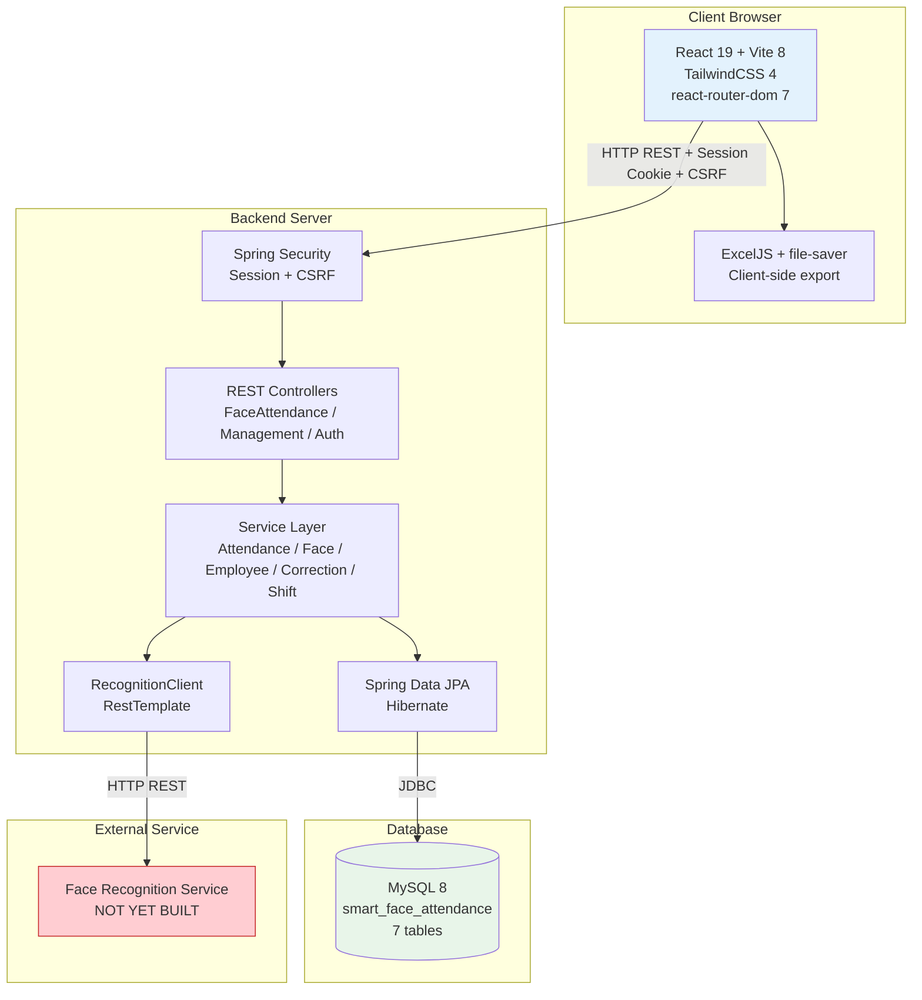
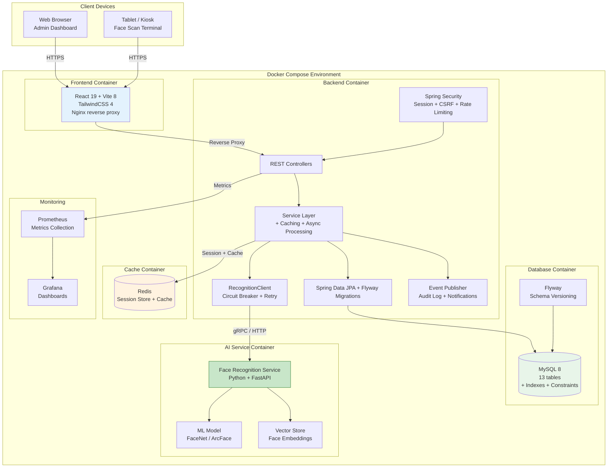

# Component and Deployment Diagrams

## Current System Architecture

## Proposed Architecture (After Improvements)

## Component Interaction Summary

| Component | Technology | Purpose | Status |
|-----------|-----------|---------|--------|
| Frontend | React 19 + Vite 8 | Admin/Employee dashboards | IMPLEMENTED |
| Backend API | Spring Boot + JPA | REST API, business logic | IMPLEMENTED |
| Database | MySQL 8 | Persistent storage | IMPLEMENTED (7 tables) |
| Security | Spring Security | Session auth + CSRF | IMPLEMENTED |
| Face Recognition | Python + FastAPI | Face identify/enroll | NOT BUILT |
| Redis Cache | Redis | Session store, caching | PROPOSED |
| Schema Migration | Flyway | Version-controlled DDL | PROPOSED |
| Monitoring | Prometheus + Grafana | System observability | PROPOSED |
| Containerization | Docker Compose | Deployment orchestration | PROPOSED |

## Deployment Phases

| Phase | Components Added | Infrastructure Changes |
|-------|-----------------|----------------------|
| Phase 1 | Daily summary table, grace minutes | Flyway migration, index optimization |
| Phase 2 | Face Recognition Service, device management | Docker Compose, Python container, gRPC |
| Phase 3 | Departments, leave management, notifications | Redis for caching, async event processing |
| Phase 4 | Audit logging, monitoring, CI/CD | Prometheus + Grafana, GitHub Actions pipeline |
