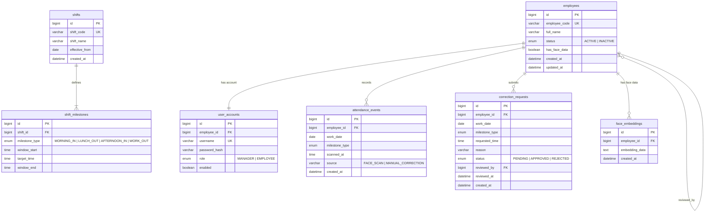
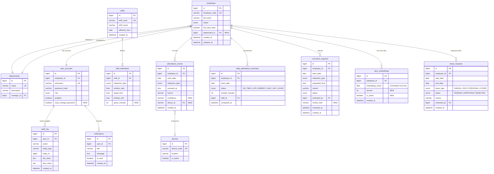

# ER Diagram: Database Schema

## Current Schema (7 Tables)

## Proposed Schema (13 Tables, Phase 1-4 additions)

## Database Change Summary

| Phase | New Tables | Modified Tables | Key Changes |
|-------|-----------|----------------|-------------|
| Phase 1 | daily_attendance_summary | shift_milestones (grace_minutes), attendance_events (confidence) | Pre-computed daily status, configurable grace period |
| Phase 2 | devices | attendance_events (device_id) | Multi-device support, device-linked scans |
| Phase 3 | departments, leave_requests | employees (department_id) | Organizational structure, leave management |
| Phase 4 | audit_log, notifications | user_accounts (must_change_password), face_embeddings (version, is_active) | Compliance logging, face data versioning |
