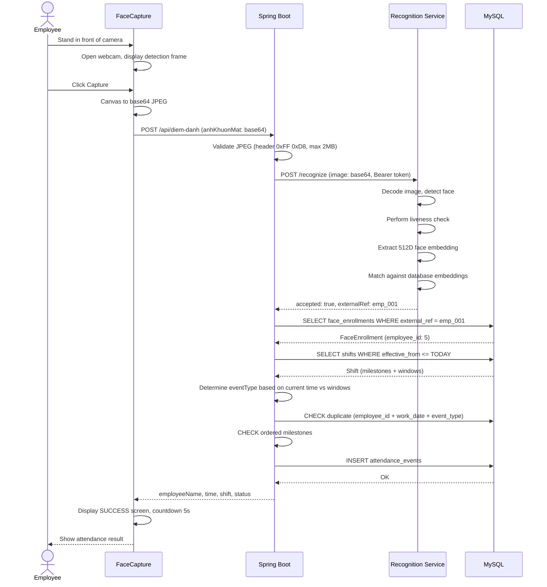

# Sequence Diagram: Face Attendance Scan Flow

> Complete flow from employee standing in front of camera to attendance record. The Recognition Service (Python) is the component that needs to be built — currently the backend only makes HTTP calls to a configured URL.
