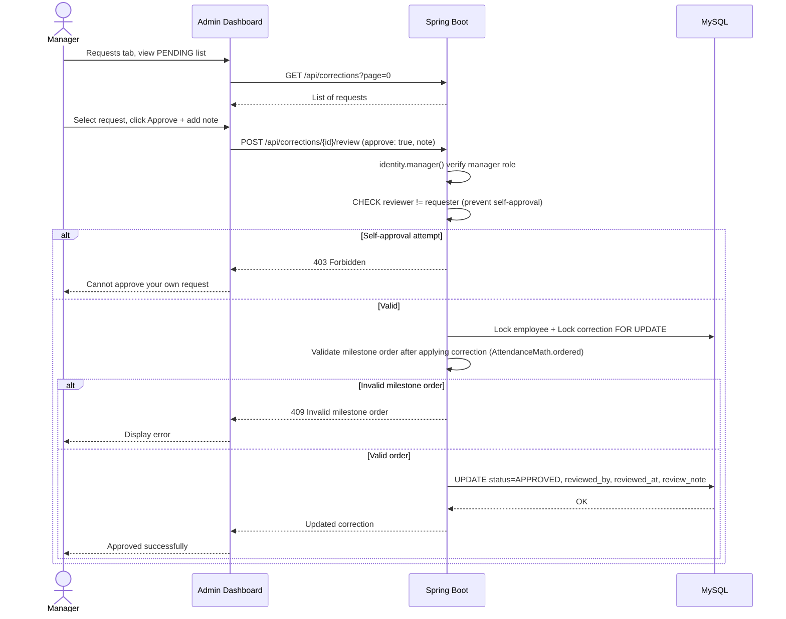

# Sequence Diagram: Review Correction Request (Manager)

> Corrections are applied using a "soft" approach — original records in `attendance_events` are never modified. Instead, the `effective()` method merges APPROVED corrections when displaying attendance data. This ensures data integrity.
