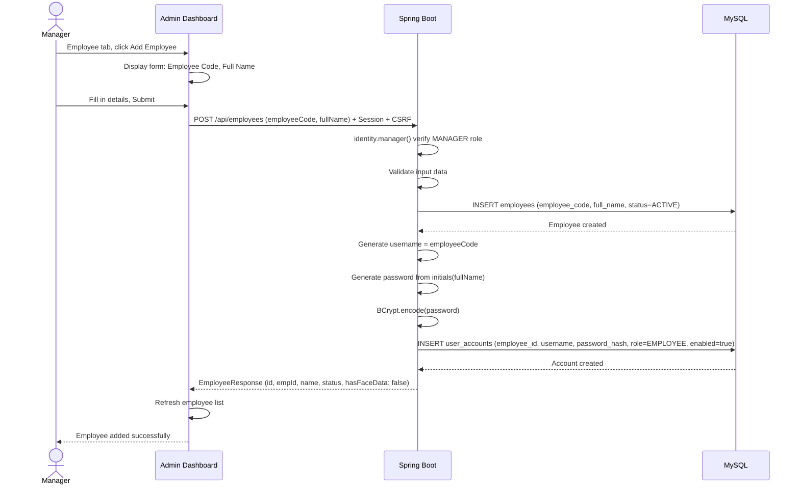

# Sequence Diagram: Employee Management — Create

> When creating a new employee, the system automatically creates a user account (username = employee code, password from name initials). The employee should change their password on first login.
