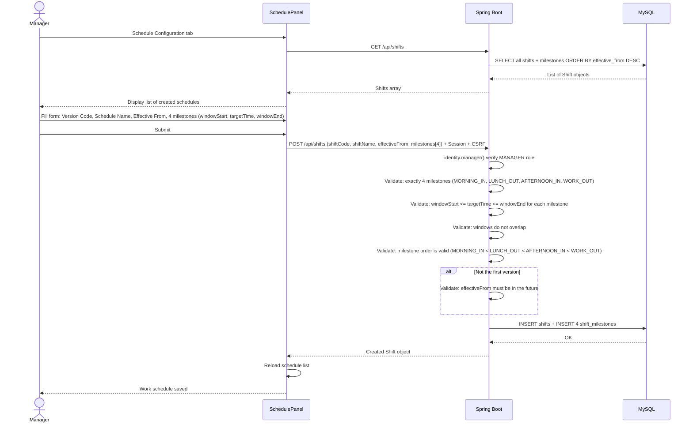

# Sequence Diagram: Work Schedule Configuration Flow

> This is a fixed schedule applied uniformly to all employees, not shift assignment. New versions are created only when the general working hours change; old schedules are preserved for historical attendance records.
