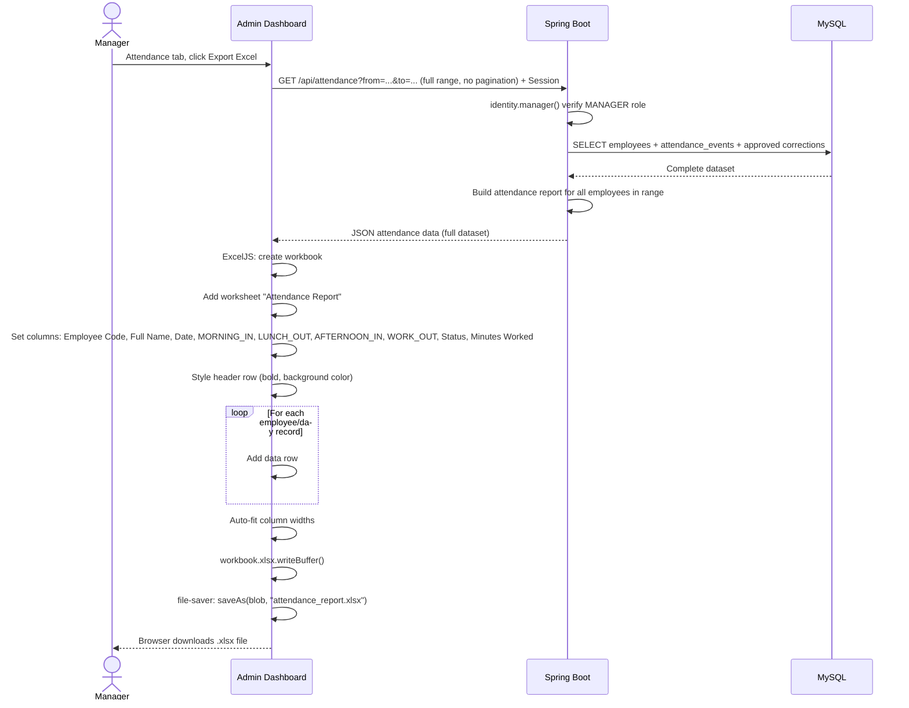

# Sequence Diagram: Excel Export Flow

> Excel generation happens entirely on the client side using ExcelJS and file-saver. The backend only provides the JSON data; no server-side file generation is involved.
