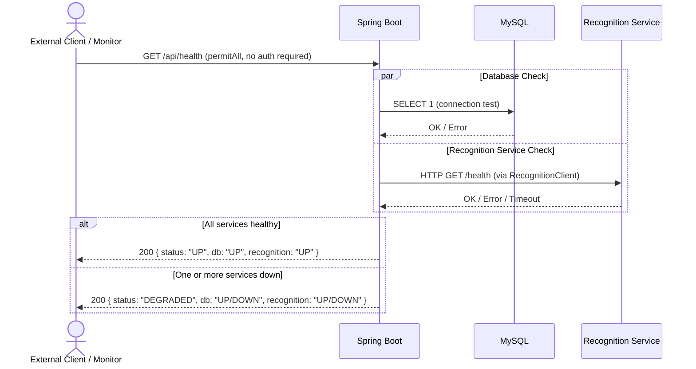

# Sequence Diagram: Health Check

> The health endpoint is publicly accessible (permitAll) so monitoring tools can check system status without authentication. The recognition service is expected to be unavailable until it is built.
