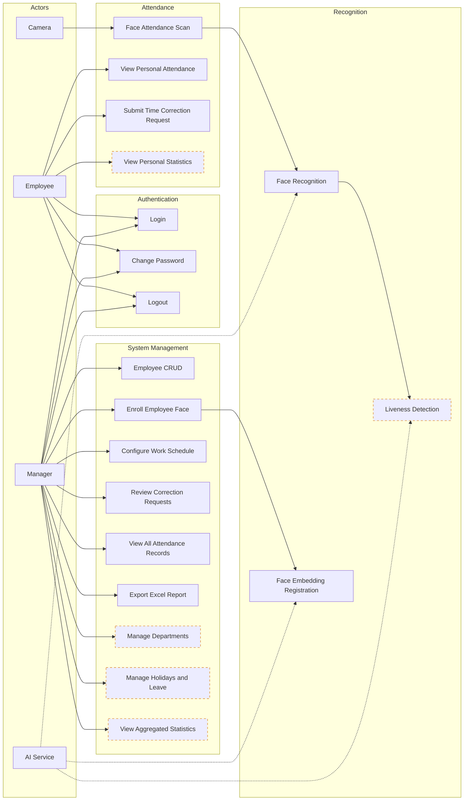

# Use Case Diagram — Smart Face Attendance

## Overview

> Dashed outline = proposed features (not yet implemented in the current system).

## Use Case Details

| ID | Use Case | Actor | Description | Status |
|----|----------|-------|-------------|--------|
| UC1 | Login | EMP / MGR | Authenticate with username + password, create session + CSRF token | IMPLEMENTED |
| UC2 | Change Password | EMP / MGR | Verify current password, set new password (minimum 12 characters) | IMPLEMENTED |
| UC3 | Logout | EMP / MGR | Invalidate session, clear CSRF token | IMPLEMENTED |
| UC4 | Face Attendance Scan | Camera | Capture photo, send to API, recognize face, record attendance event | IMPLEMENTED |
| UC5 | View Personal Attendance | EMP | View 4 milestones, status, worked minutes by month | IMPLEMENTED |
| UC6 | Submit Correction Request | EMP | Select date + milestone + proposed time + reason, submit as PENDING | IMPLEMENTED |
| UC7 | Employee Management | MGR | Create/update/deactivate employees + auto-create user accounts | IMPLEMENTED |
| UC8 | Face Enrollment | MGR | Capture employee photo, send to enroll endpoint, save externalRef | IMPLEMENTED |
| UC9 | Schedule Configuration | MGR | Create new schedule version with 4 milestones (target + window) | IMPLEMENTED |
| UC10 | Review Corrections | MGR | View + approve/reject, validate milestone order, prevent self-approval | IMPLEMENTED |
| UC11 | View All Attendance | MGR | All employee attendance records, filter by date/status/search | IMPLEMENTED |
| UC12 | Export Excel | MGR | Export attendance data to .xlsx file (ExcelJS) | IMPLEMENTED |
| UC13 | Personal Statistics | EMP | Personal attendance charts, tardiness trends | PROPOSED |
| UC14 | Department Management | MGR | CRUD departments, assign employees to departments | PROPOSED |
| UC15 | Leave Management | MGR / EMP | Employee submits leave request, manager approves, auto-deduct from attendance | PROPOSED |
| UC16 | Aggregated Statistics | MGR | Dashboard with charts by department, month, trends | PROPOSED |
| UC17 | Face Recognition | AI | Match face embedding against database, return externalRef | NOT BUILT |
| UC18 | Embedding Registration | AI | Create 512D face vector from photo, store in face DB | NOT BUILT |
| UC19 | Liveness Detection | AI | Detect fake photos, videos, 3D masks | PROPOSED |
